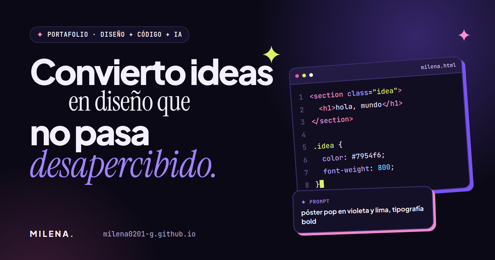

<p align="center">
  
</p>

<p align="center">
  
</p>

<p align="center">
  <a href="https://milena0201-g.github.io/">
    
  </a>
</p>

<p align="center">
  <a href="https://milena0201-g.github.io/">
    
  </a>
  &nbsp;
  <a href="https://www.linkedin.com/in/milena-guevara-s%C3%A1nchez-2a94343a3/">
    
  </a>
  &nbsp;
  <a href="mailto:milenita020105@gmail.com">
    
  </a>
</p>

---

## 🙋‍♀️ Sobre mí

```text
> Hola, soy Milena Guevara Sánchez.
> Estudiante de Diseño Gráfico Digital en SENATI.
> Curiosa por naturaleza, creativa por elección.
```

Me gusta que cada pieza tenga una intención: que **comunique algo antes de leer una sola palabra**. Disfruto el proceso tanto como el resultado: bocetar, probar combinaciones, equivocarme y volver a empezar hasta que la idea se ve como la imaginé.

---

## 🎨 Lo que hago

<table align="center">
  <tr>
    <td align="center" width="33%">
      <h3>🎯</h3>
      <b>Identidad visual</b><br />
      <sub>Marcas con personalidad propia</sub>
    </td>
    <td align="center" width="33%">
      <h3>📐</h3>
      <b>Composición</b><br />
      <sub>Orden, ritmo y jerarquía</sub>
    </td>
    <td align="center" width="33%">
      <h3>🌈</h3>
      <b>Color y tipografía</b><br />
      <sub>Paletas y letras que hablan</sub>
    </td>
  </tr>
  <tr>
    <td align="center">
      <h3>✏️</h3>
      <b>Ilustración</b><br />
      <sub>Vectores y trazos limpios</sub>
    </td>
    <td align="center">
      <h3>📷</h3>
      <b>Edición fotográfica</b><br />
      <sub>Retoque y fotomontaje</sub>
    </td>
    <td align="center">
      <h3>📱</h3>
      <b>Diseño digital</b><br />
      <sub>Pantallas para apps y web</sub>
    </td>
  </tr>
</table>

---

## 🧰 Herramientas

<table align="center">
  <tr>
    <td align="center" width="50%">
      <h3>🖌️ Diseño</h3>
      
      <br /><br />
      
    </td>
    <td align="center" width="50%">
      <h3>💻 Código & IA</h3>
      
      <br /><br />
      
    </td>
  </tr>
</table>

<table align="center">
  <tr>
    <th align="center">Herramienta</th>
    <th align="center">Para qué la uso</th>
  </tr>
  <tr>
    <td align="center"><b>Photoshop</b></td>
    <td align="center">Retoque, fotomontajes y tratamiento de imágenes</td>
  </tr>
  <tr>
    <td align="center"><b>Illustrator</b></td>
    <td align="center">Vectores, logotipos y piezas gráficas</td>
  </tr>
  <tr>
    <td align="center"><b>CorelDRAW</b></td>
    <td align="center">Diseño para impresión y trazos limpios</td>
  </tr>
  <tr>
    <td align="center"><b>Adobe XD</b></td>
    <td align="center">Pantallas y flujos para apps y sitios web</td>
  </tr>
  <tr>
    <td align="center"><b>Figma</b></td>
    <td align="center">Prototipos interactivos y trabajo colaborativo</td>
  </tr>
</table>

---

## 💻 Código & IA

No soy programadora, pero me gusta entender cómo se construye lo que diseño. Conozco lo básico, lo suficiente para dar vida a una idea.

```js
const milena = {
  html: "estructuro páginas sencillas",
  css: "colores, tipografías y layouts simples",
  javascript: "pequeñas interacciones, primeros pasos",
  ia: "prompts claros para referencias, moodboards e imágenes",
};
```

---

## ✨ El portafolio por dentro

<table align="center">
  <tr>
    <th align="center">🎬 Experiencia</th>
    <th align="center">⚙️ Bajo el capó</th>
  </tr>
  <tr>
    <td>🖥️ Siete vistas a pantalla completa</td>
    <td>⚡ HTML, CSS y JavaScript puros</td>
  </tr>
  <tr>
    <td>🎞️ Una animación distinta por sección</td>
    <td>⌨️ Navegable con teclado</td>
  </tr>
  <tr>
    <td>🌐 Español e inglés automático</td>
    <td>♿ Respeta «reducir movimiento»</td>
  </tr>
  <tr>
    <td>🌙 Tema oscuro que hace resaltar el color</td>
    <td>📱 Responsive en escritorio, tablet y celular</td>
  </tr>
  <tr>
    <td>🧩 Herramientas interactivas</td>
    <td>🔗 Vista previa lista para redes sociales</td>
  </tr>
  <tr>
    <td>📋 Copiar correo con un clic</td>
    <td>🚀 Publicado con GitHub Pages</td>
  </tr>
</table>

---

## 📬 Contacto

<p align="center">
  <b>¿Tienes una idea? Escríbeme y conversemos.</b>
</p>

<p align="center">
  <a href="https://milena0201-g.github.io/">
    
  </a>
  <a href="https://www.linkedin.com/in/milena-guevara-s%C3%A1nchez-2a94343a3/">
    
  </a>
  <a href="mailto:milenita020105@gmail.com">
    
  </a>
  <a href="https://github.com/milena0201-g">
    
  </a>
</p>

<p align="center">
  
</p>
